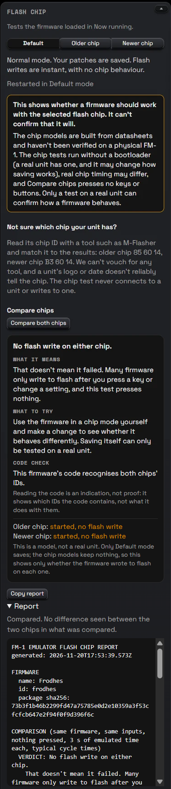

<div align="center">

# FM-1 Emulator

An offline desktop emulator for the **M-VAVE FM-1**. Run FM-1 firmware with no hardware:
choose a firmware, press **Start**, and play with your keyboard, mouse, or a MIDI controller.

[](https://github.com/HEATWAVS/fm1-emulator/releases/latest)
[](https://github.com/HEATWAVS/fm1-emulator/releases)
[](LICENSE)


</div>

---

## What's new in 1.1.4

- **Flash chip testing.** Run a firmware against a model of the older chip (Puya P25Q80H) or the newer chip (UC25HQ80) before you flash it. The chip modes keep nothing; only Default saves your patches.
- **Compare chips.** Runs the loaded firmware on both chip models and gives a plain verdict on whether it started and wrote to flash on each. It also checks the code for the chips' IDs and produces a report you can copy.
- **CPU optimization.** A validated speed-up that reduces overload on some firmware. It helps only firmware whose second core waits in a loop (about a quarter of the bundled packages) and is not a fix for every firmware.
- **Desktop window** now opens maximized, and the Firmware radar moved under Install firmware.

This does not prove a firmware works on a real FM-1. See the [release notes](docs/RELEASE-NOTES-1.1.4.md) and the known limitations below.

<p align="center">
  
</p>

## What's new in 1.1.3

USB recovery guidance and safer Windows firmware selection, plus playback hardening, Focus, and patch-bay controls.
## 1.1.2

Patch bay · generative modules · cable motion · desktop MIDI link · colour themes.

## Download

Get the latest build for your system from the [**Releases**](https://github.com/HEATWAVS/fm1-emulator/releases/latest) page.

| OS | File |
| --- | --- |
| **Windows** | `FM-1-Emulator-Setup-*.exe` (installer) or `*-portable.exe` (no install) |
| **macOS** | `*-arm64.dmg` (Apple Silicon) · `*-x64.dmg` (Intel) |
| **Linux** | `*.AppImage` or `*.deb` |

<p align="center">
  
</p>

## First launch

The builds aren't code-signed, so your OS shows a **one-time warning** the first time. It's safe —
here's how to get past it:

- **macOS** — right-click (or Control-click) the app → **Open** → **Open**. (A double-click only shows
  a *Cancel* button; right-clicking gives you the **Open** button.) If it says **"damaged"**, run in
  Terminal: `xattr -dr com.apple.quarantine "/Applications/FM-1 Emulator.app"` then
  `codesign --force --deep --sign - "/Applications/FM-1 Emulator.app"`.
- **Windows** — if SmartScreen appears, click **More info → Run anyway**.
- **Linux** — the `.deb` is easiest. For the AppImage, if it won't start: `sudo apt install libfuse2`
  (Ubuntu 24.04: `libfuse2t64`), and on Ubuntu 24.04 run with `--no-sandbox` if you hit a sandbox error.

Full per-platform detail: **[Installation & first run](docs/Installation.md)**.

## Features

- **Open-source firmwares bundled** — 277 packages, newest first, unique, fully offline
- **Search every firmware** — names, IDs, versions, authors, licenses, products, descriptions
- **Update radar** — finds newly published open-license packages; downloads only when you pick one
- **Load your own** — drag any `.fwsc` onto the window
- **Play** — computer keyboard, mouse, or USB MIDI
- **Patch bay** — generative modules with presets, grooves, and moving cables
- **Desktop MIDI** — Bluetooth or USB link to a paired FM-1
- **Focus Mode** — enlarge the LCD screen to fit the window (header, next to Flash; close with ✕ or Escape); session export/import for UI prefs
- **Themes** — Midnight, Graphite, Cobalt, Emerald, Crimson, Vaporwave, Ice, Paper
- **Customize** — panel colours, decals, stickers
- **Firmware recovery (Windows)** — backup, restore, reinstall

## Colours

<p align="center">
  
  
</p>
<p align="center">
  
  
</p>
<p align="center">
  
  
</p>
<p align="center">
  
  
</p>

<p align="center">
  
  
</p>
<p align="center">
  
  
</p>

## Recovery & safety

The emulator runs firmware purely in software — it cannot harm your computer or your FM-1. The only
risk is flashing real hardware. The app tries to help you recover (backup, resume, roll back, Windows
flash recovery tool), but **a real flash can still brick a unit**, and **the author is not
responsible for any bricked or damaged FM-1** — you flash at your own risk. Details:
**[Hardware flashing & recovery](docs/Recovery.md)** · **[Disclaimer](DISCLAIMER.md)**.

## Help

- **[Installation & first run](docs/Installation.md)** — the unsigned-app warning on Windows, macOS, and Linux
- **[Troubleshooting](docs/Troubleshooting.md)** — no sound, MIDI not detected, a firmware won't boot, settings not saving
- **[Firmware](docs/Firmware.md)** — switching firmware and loading your own `.fwsc`
- **[Hardware flashing & recovery](docs/Recovery.md)** — for a real FM-1 unit

## Firmware & licensing

Only firmwares published under a clear redistributable open-source license, with available source
and a passing emulator boot audit, are bundled. Packages use GPL, MPL, or another compatible
open license and are redistributed unchanged with credit — see [THIRD-PARTY.md](THIRD-PARTY.md) and
the exact hashes in [FIRMWARE-SOURCES.json](FIRMWARE-SOURCES.json). Packages with missing or
unverifiable licensing, restricted media, a wrong-device identity, or a failed boot check stay out.
The M-VAVE stock firmware is not bundled; load your own `.fwsc` to run it.

## Emulation engine and known limitations

The emulator runs firmware on one engine: the unified engine (upstream fm1-emu v0.3.0 plus this project's patches) with a validated CPU optimization that skips loops the second CPU core provably cannot leave. Firmware runs unmodified and, across all 277 bundled packages, behaves identically with the optimization on and off. The optimization speeds up only firmware whose second core spends time in a provable wait loop (about a quarter of the bundled packages). It is not a general speed-up: firmware that does real work on both cores is emulated at the same speed with or without it. The original engine file stays in the app only to draw the front panel and as a *Previous engine* reference mode in the Flash chip test panel (test modes never save).

Known limitations (details in `docs/dev/ARCHITECTURE.md`):

- **15 firmware packages** (`amb`, `amenity`, `assid`, `atek303`, `choppah`, `ctl`, `fm1-ripple`, `fmfam`, `krisjangle`, `loom`, `midimon`, `mutable`, `polly`, `remotefm1`, `sidou`) start their audio engine now; on the previous engine they never did. The audio-clock (PLL0) values behind this come from the upstream emulator and have **not** been verified on a physical FM-1.
- **Six firmware packages** (`xenolith`, `fm1-mighty-arp`, `tonic-fm1`, `fm1-yoga`, `tidepool-fm1`, `matryoshka`) behave differently from the previous engine when USB audio is streamed to them (the previous engine disturbed firmware that ignores the stream; the new one does not). Not checked against hardware.
- **`dx747` and `clatter`** write a different 33-byte flash record and show small audio differences from the previous engine, because the new engine decrypts the bytes after the app area (as upstream does). Which one a physical FM-1 shows is not known.
- **The official stock `FM-1.fwsc`** (not bundled) now boots, but its sound generation and its complete screen/UI have **not** been verified; in the checks it drew only a status bar and produced silent audio, and it ran at about 0.1x real time (so it is not usable interactively yet).
- **Heavy firmware** can need more processing than a PC can deliver in real time, so its audio may underrun. In the checks the slowest bundled packages were `duell`, `playa`, `dark1`, `perf1`, `penumbra`, `satie1` and `386dx`, which ran well below real time under load; `frodhes` and `melodee` were close behind. This is emulation overhead, not a fault in the firmware, and the CPU optimization does not remove it. Running comfortably on the FM-1 hardware does not guarantee real-time speed here.
- **Not tested:** listening on a real audio device, the packaged application on macOS and Linux, and anything on physical hardware.

## Build from source

Requires [Node.js](https://nodejs.org) 18+.

```bash
git clone https://github.com/HEATWAVS/fm1-emulator.git
cd fm1-emulator
npm install
npm start            # run it
npm run dist:win     # or dist:mac / dist:linux to package
```

Release builds for all three platforms are produced by GitHub Actions on each tag.

Maintainers can refresh the open firmware set with `npm run sync:firmwares`; the command verifies
every SHA-256 hash and FM-1 product identity and removes superseded package files.
Run `npm run audit:firmwares -- --out <directory>` to boot every package in an isolated emulator,
check for CPU halts or blank LCDs, and write a machine-readable report plus LCD captures.

## Credits

A fork of [briksquared/fm1-emulator](https://github.com/briksquared/fm1-emulator) (MIT), which is itself a fork of [fm1-emu](https://github.com/joakimeriksson/fm1-emu) by Joakim Eriksson (MIT), which
provides the Rust→WebAssembly emulation engine. What this fork changes is listed in [CHANGELOG.md](CHANGELOG.md). Firmware by the authors listed in
[THIRD-PARTY.md](THIRD-PARTY.md).

## License

[MIT](LICENSE). See [NOTICE.md](NOTICE.md) for the fork, bundled-firmware, and trademark notices.
Unofficial — not affiliated with, authorized by, or endorsed by M-VAVE. See [DISCLAIMER.md](DISCLAIMER.md).
